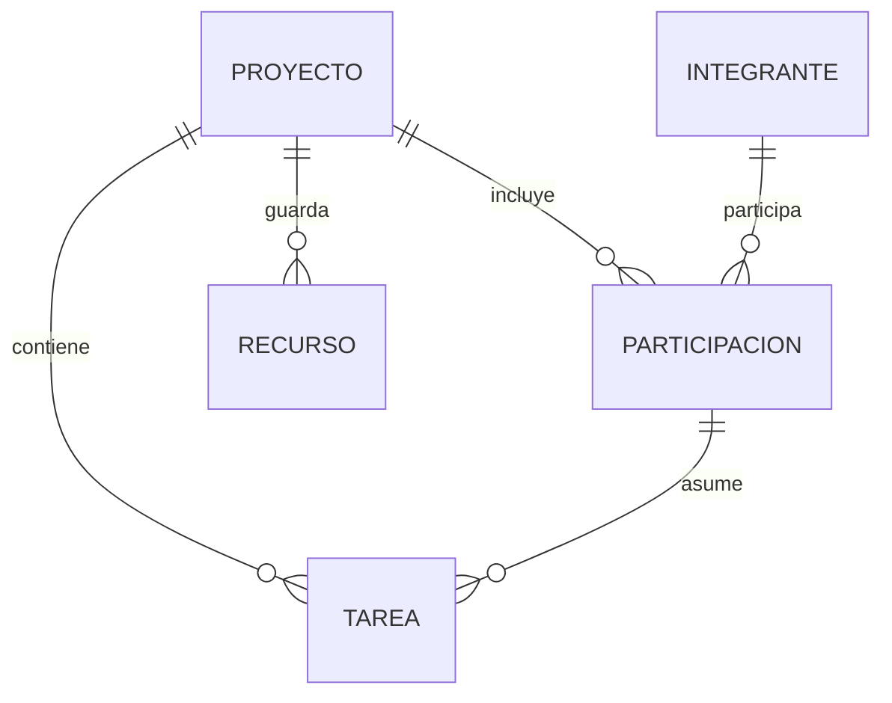
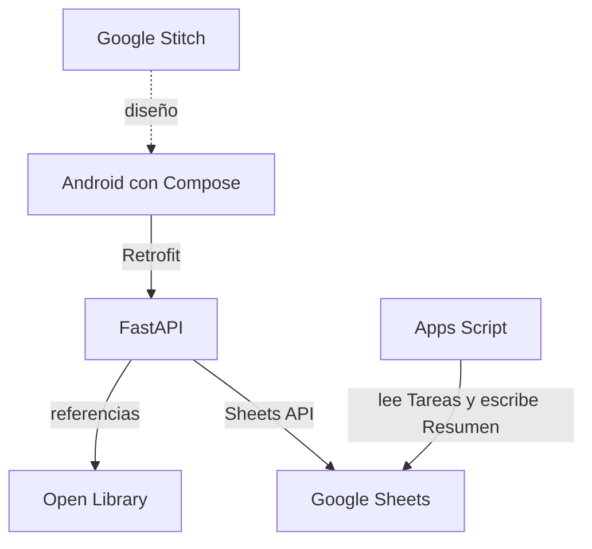

# StudyFlow para Android

Cuando el equipo reparte una exposición por chat, buscar la última asignación puede tomar más tiempo que consultar la tarea. StudyFlow reúne proyectos, tareas, responsables y referencias en el teléfono. El estudiante abre su proyecto y sabe qué preparar y con quién.

## Primera entrega

Inicio muestra proyectos y pendientes. Tocar una tarjeta abre el detalle con tareas y responsables. Herramientas permite actualizar el panel desde FastAPI por Retrofit. El arranque usa ejemplos locales para poder presentar la navegación sin servidor. El backend sirve ejemplos en memoria. En Herramientas se pueden buscar títulos en Open Library y leer la pestaña Resumen mediante Sheets API. Sheets requiere credenciales en el servidor.

| Vista | Ruta utilizada | Ampliación prevista |
|---|---|---|
| Inicio | GET /api/panel | Leer proyectos desde Sheets |
| Detalle | Selección por ID en la respuesta de GET /api/panel | Incorporar referencias guardadas |
| Herramientas | GET /api/panel al actualizar | GET /api/libros?consulta= y GET /api/resumen implementados |

## Modelo

Cada colección se consulta con GET /api/ seguido de su nombre: proyectos, integrantes, participaciones, tareas o recursos. Participación indica qué persona trabaja en qué proyecto. Una tarea referencia al participante responsable. Un recurso identifica la referencia bibliográfica guardada para un proyecto.



## Arquitectura objetivo



- **Stitch** permite acordar el recorrido y reproducir sus componentes en Compose. Crear las tres vistas y conservar el enlace compartido y las capturas. [Google Stitch](https://stitch.withgoogle.com/)
- **Sheets API** permitirá mantener datos tabulares que el grupo también pueda revisar en la hoja. Para una hoja compartida del proyecto se propone una cuenta de servicio en el servidor. Compartir únicamente esa hoja con la cuenta.
- **Apps Script** genera una pestaña Resumen a partir de Tareas. En una hoja de prueba crear Tareas con encabezados Proyecto, Título y Estado. Pegar automatizacion/Resumen.gs en el editor vinculado y ejecutar actualizarResumen. Para automatizarlo, añadir un desencadenador temporal. El script reemplaza el contenido de Resumen en cada ejecución.
- **Open Library** aportará títulos, autores e identificadores. La API de StudyFlow traducirá la consulta del usuario a search.json y devolverá referencias al teléfono. [Documentación](https://openlibrary.org/dev/docs/api/search)

## Ejecución en Windows

1. Abrir la carpeta que contiene settings.gradle.kts en Android Studio. Instalar Android SDK 36, seleccionar JDK 17 o compatible y sincronizar Gradle con acceso a Internet.
2. Ejecutar el módulo app en un emulador Android API 24 o superior. Para construir desde PowerShell usar `.\gradlew.bat :app:assembleDebug`.
3. Para probar la actualización desde el servidor, ejecutar en la raíz:

```powershell
python -m venv .venv
.\.venv\Scripts\python -m pip install -r backend/requirements.txt
.\.venv\Scripts\python -m uvicorn backend.main:app --port 8000
```

Abrir http://localhost:8000/docs. En el emulador, Herramientas → Actualizar desde la API utiliza http://10.0.2.2:8000/. El texto de la primera tarea cambia a «Investigar patrones». La URL está en app/build.gradle.kts. El manifiesto de debug admite HTTP local.

Para activar Sheets en PowerShell, establecer $env:GOOGLE_SHEETS_ID y $env:GOOGLE_APPLICATION_CREDENTIALS antes de iniciar Uvicorn. Usar .env.example como referencia. GOOGLE_SHEETS_ID identificará la hoja y GOOGLE_APPLICATION_CREDENTIALS apuntará a un archivo privado del servidor. El servidor de ejemplo funciona sin esas variables.

## Organización

| Carpeta | Contenido |
|---|---|
| app/src/main | Interfaz Compose Material 3, estado del ViewModel y contrato Retrofit |
| app/src/debug | Configuración de red para el emulador |
| backend | API de lectura y dependencias |
| automatizacion | Script vinculado a Google Sheets |
| gradle/wrapper | Versión reproducible de Gradle |

## GitHub Flow

Remoto: https://github.com/angelvillada-pixel/web-design-studyflow.git. El repositorio ya tiene una rama inicial. Los comandos históricos de arranque desde un remoto vacío son:

```powershell
git remote add origin https://github.com/angelvillada-pixel/web-design-studyflow.git
git symbolic-ref HEAD refs/heads/main
git commit --allow-empty -m 'chore: iniciar repositorio'
git push -u origin main
git switch -c feat/esqueleto-android
git add .
git commit -m 'feat: preparar StudyFlow Android'
git push -u origin feat/esqueleto-android
```

El propietario invita a sus compañeros en Settings → Collaborators. Abrir un PR de feat/esqueleto-android hacia main, pedir revisión a otro integrante y fusionar después de su aprobación. Para el siguiente hito:

```powershell
git switch main
git pull --ff-only
git switch -c feat/diseno-stitch
# Incorporar las capturas y el enlace real
git add README.md docs
git commit -m "docs: incorporar prototipo de Stitch"
git push -u origin feat/diseno-stitch
```

## Evidencias por incorporar

| Evidencia | Estado |
|---|---|
| Enlace al proyecto de Stitch y capturas de sus tres vistas | Pendiente del prototipo en Stitch |
| Captura de la aplicación en el emulador | Pendiente de compilación y ejecución |
| PR con revisión de un compañero | Pendiente de publicación |
| Enlace al video | Pendiente de grabación |

## Guion del video (4 min 30 s)

Distribución sugerida para tres participantes. Si cambia el tamaño del grupo, repartir los 270 segundos por igual.

1. **0:00–1:30 · Problema y diseño.** Mostrar el prototipo de Stitch. «Cuando repartimos una exposición por chat perdemos de vista quién prepara cada parte. Diseñamos StudyFlow para consultar el proyecto, encontrar nuestras tareas y revisar los recursos desde el celular». Recorrer las tres vistas del diseño y señalar qué acción inicia cada una.
2. **1:30–3:00 · Arquitectura.** Mostrar los dos diagramas. «Cada proyecto reúne participantes, tareas y fuentes. La participación relaciona una persona con un proyecto y permite asignarle trabajo. Compose presenta el estado del ViewModel y Retrofit consulta FastAPI». Explicar cómo Sheets almacenará datos, Apps Script resumirá pendientes y Open Library aportará bibliografía.
3. **3:00–4:30 · Demostración.** Abrir la app, entrar al proyecto y mostrar una tarea. Actualizar desde Herramientas con la API levantada y volver al detalle para enseñar el cambio. Mostrar el PR revisado y explicar cuáles conexiones se demostraron y cuáles quedan como siguiente hito.
